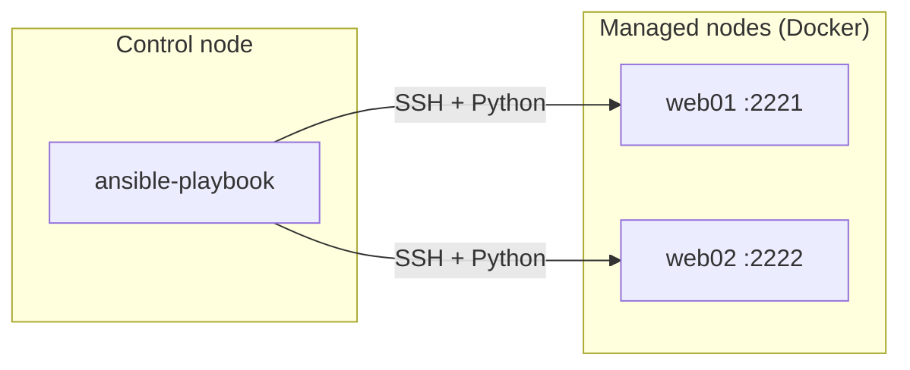

# Ansible playground (production-style layout)

Practice environment: **one control node** (your Mac or the `control` container) drives **many managed nodes** (`web01`, `web02`) over SSH. Configuration lives in `.env` — intentional for a local lab, not for real secrets.

**Learning path:** [docs/FUNDAMENTALS.md](docs/FUNDAMENTALS.md) (`make`, folders, `.env`) → [docs/ANSIBLE-FUNDAMENTALS.md](docs/ANSIBLE-FUNDAMENTALS.md) (Ansible concepts) → [docs/NEXT-STEPS.md](docs/NEXT-STEPS.md) (roadmap to production habits).

## Architecture



Production patterns included:

| Pattern | Location |
|--------|----------|
| Static inventory with groups | `ansible/inventory/hosts.yml` |
| `group_vars` / `host_vars` | `ansible/group_vars`, `ansible/host_vars` |
| Entry playbook `site.yml` + roles | `ansible/playbooks/site.yml`, `ansible/roles/` |
| Rolling updates (`serial: 1`) | `ansible/playbooks/site.yml` |
| Collections pin | `ansible/collections/requirements.yml` |
| Fact caching | `ansible/ansible.cfg` |

## Quick start

1. **Start targets**

   ```bash
   make up
   ```

2. **Install collections** (once)

   ```bash
   make galaxy
   ```

3. **Prove one controller → many nodes**

   ```bash
   make smoke
   # or: make ping
   ```

4. **Configure everything like a real deploy**

   ```bash
   make site
   ```

5. **Check nginx** (after `make site`)

   ```bash
   curl -sS http://127.0.0.1:8081   # web01
   curl -sS http://127.0.0.1:8082   # web02
   ```

## Run Ansible inside a dedicated control container

Same inventory, but the controller is a container on the Docker network (hostnames `web01` / `web02`, port 22):

```bash
docker compose --profile control build control
make control-shell
# inside container:
ansible-galaxy collection install -r collections/requirements.yml -p collections
ansible-playbook playbooks/smoke.yml
ansible-playbook playbooks/site.yml
```

## Manual SSH

```bash
make ssh-web01
make ssh-web02
```

User/password (password auth still enabled for learning): see `.env` (`ANSIBLE_SSH_USER` / `ANSIBLE_SSH_PASSWORD`). Key-based auth uses `ssh/ansible_control_ed25519`.

## Environment variables

All connection and identity settings are in [`.env`](.env). Inventory reads hosts/ports/user via `lookup('env', ...)`, so you can switch between **host controller** (`127.0.0.1:2221/2222`) and **container controller** (`web01:22`, `web02:22`) without editing YAML.

## Adding a third node

1. Copy a service block in `docker-compose.yml` → `web03`, new port in `.env`.
2. Add `web03` under `webservers` in `ansible/inventory/hosts.yml`.
3. Add `ansible/host_vars/web03.yml`.
4. `make up && make site` — the same control node configures the new host.